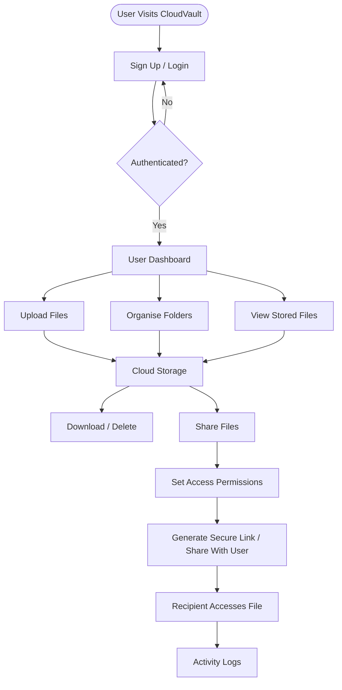

# ☁️ CloudVault
### Secure Cloud-Based File Storage and Sharing Platform

# Live Website- http://13.232.53.200:3000/


<p align="center">
  <strong>Store. Organise. Share. Securely.</strong>
</p>

<p align="center">
  A secure and reliable cloud storage platform that allows users to upload, manage, access, and share files from anywhere.
</p>

---

## 📌 About The Project

**CloudVault** is a cloud-based file storage and sharing platform designed for **students, individuals, and small teams** who need a secure and convenient way to manage their digital files.

Storing important documents on personal laptops, USB drives, or email attachments can lead to **data loss, limited accessibility, and security risks**.

CloudVault addresses these challenges by providing a centralised storage system where users can securely upload, organise, download, and share files with controlled permissions.

Inspired by platforms like **Google Drive** and **Dropbox**, CloudVault aims to deliver essential cloud storage capabilities through a simple, secure, and user-friendly interface.

## 🎯 Objectives

- **Reliable Storage:** Provide centralised cloud storage with anytime, anywhere file access.
- **Authentication:** Ensure that only authenticated users can access their accounts and resources.
- **Authorisation:** Implement controlled access to files through defined user permissions.
- **Secure Sharing:** Enable safe file sharing through user-based access and secure links.
- **Monitoring:** Track file activities, user actions, and overall system health.
- **Organisation:** Make file management easier through folder-based organisation.

## ✨ Key Features

| Feature | Description |
|---|---|
| 🔐 User Authentication | Secure user sign-up and login. |
| 📤 File Upload | Upload files to centralised cloud storage. |
| 📥 File Download | Access and download stored files whenever needed. |
| 🗑️ File Management | Delete files and manage stored content. |
| 📁 Folder Organisation | Organise files into folders for easier navigation. |
| 🔗 Secure Sharing | Share files with registered users or through secure links. |
| 👁️ Access Permissions | Provide view-only or download permissions. |
| 🚫 Access Revocation | Allow owners to revoke previously granted access. |
| 📋 Activity Logs | Maintain records of file access and sharing activities. |
| 📊 System Monitoring | Monitor storage usage, system health, and activity. |

## 🔒 Security

Security and access control are important components of CloudVault.

- **Authentication:** Protect user accounts through a login system.
- **Authorisation:** Restrict access to files based on ownership and permissions.
- **Controlled Sharing:** Allow owners to decide who can access shared files.
- **Permission Management:** Support view-only and download access.
- **Revocable Access:** Give file owners control over previously shared resources.
- **Activity Tracking:** Maintain logs of important user and file operations.

## ⚙️ Application Workflow



## 🛠️ Technology Stack

The technology stack will be documented as the implementation evolves.

| Component | Technology |
|---|---|
| Frontend | To be updated |
| Backend | To be updated |
| Database | To be updated |
| Cloud Storage | To be updated |
| Authentication | To be updated |
| Version Control | Git & GitHub |

## 🚀 Getting Started

Follow these steps to run CloudVault locally once the application setup is complete.

### 1. Clone the Repository

```bash
git clone https://github.com/YOUR-USERNAME/CloudVault.git
```

### 2. Navigate to the Project Directory

```bash
cd CloudVault
```

### 3. Install Dependencies

Install the required frontend and backend dependencies according to their respective setup instructions.

### 4. Configure Environment Variables

Create a `.env` file and configure the required database, storage, and authentication credentials.

### 5. Run the Application

Start the frontend and backend services using the project's configured commands.

> **Note:** Detailed installation and execution instructions will be added as development progresses.

## 📸 Screenshots

Screenshots of the CloudVault application, including the login page, dashboard, file manager, and sharing interface, will be added here.

## 🔮 Future Enhancements

- **File Versioning:** Maintain and restore previous versions of files.
- **Storage Quotas:** Set storage limits for individual users.
- **File Preview:** Preview supported documents and images without downloading.
- **Team Workspaces:** Enable collaborative file management.
- **Advanced Search:** Search files using names, types, and metadata.
- **Encryption:** Implement encryption for enhanced data protection.
- **Notifications:** Notify users about shared files and access activity.

## 👥 Team

**Developed by:**

- **Sarthak Jagota**
- **Palak Mahajan**

**Faculty Advisor:** Dr. Varinder Pal Singh

## 🤝 Contributions

Contributions, suggestions, and feedback are welcome. Feel free to fork the repository and submit a pull request.

## 📄 License

This project is currently developed for academic purposes. Licensing details will be added in the future.

---

<p align="center">
  **CloudVault — Your Files. Your Access. Your Control.**
</p>
